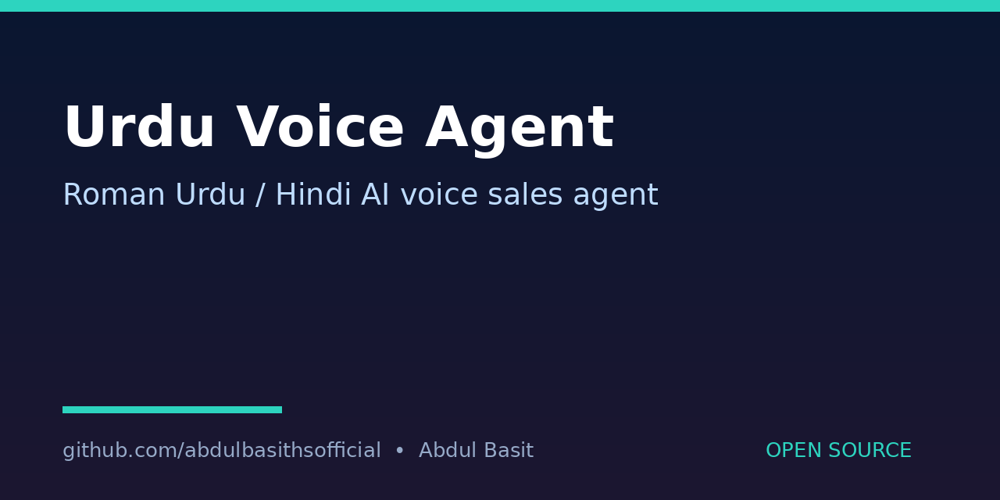

# UrduVoice-Agent
Benefit: A starter template for a bilingual Roman Urdu/Hindi AI voice sales agent, so a small business can qualify leads by voice without building the conversation flow from scratch.

## What it does
Implements the conversation flow in demo mode only: greeting, discovery, qualification, objection handling, and closing. It collects structured lead fields (business type, use case, urgency, team size, contact details) and prints them as JSON.

## Demo mode only
No real voice API is called and no API key is needed. ElevenLabs Conversational AI and Google Gemini Live API are named only as the real-world services this template is designed to be wired to later, with your own keys.

## Quick start
```bash
python3 agent.py --demo
python3 agent.py --demo --business "bakery" --urgency "this week"
```

## How to run
- `python3 agent.py --demo` runs a scripted sample conversation and prints the captured lead.
- Edit `FLOW` in `agent.py` to change questions or objection replies.
